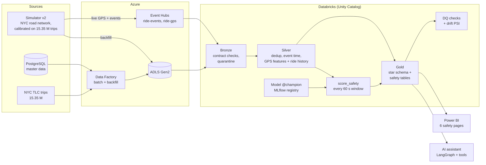
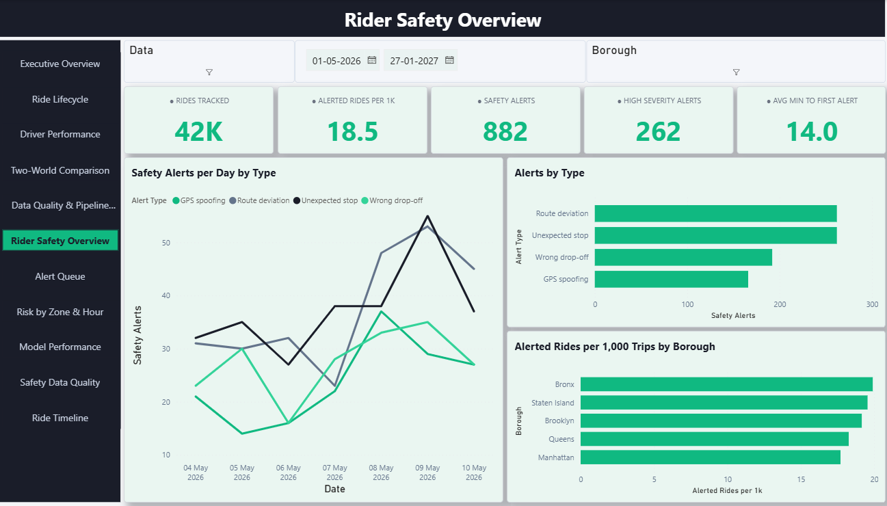
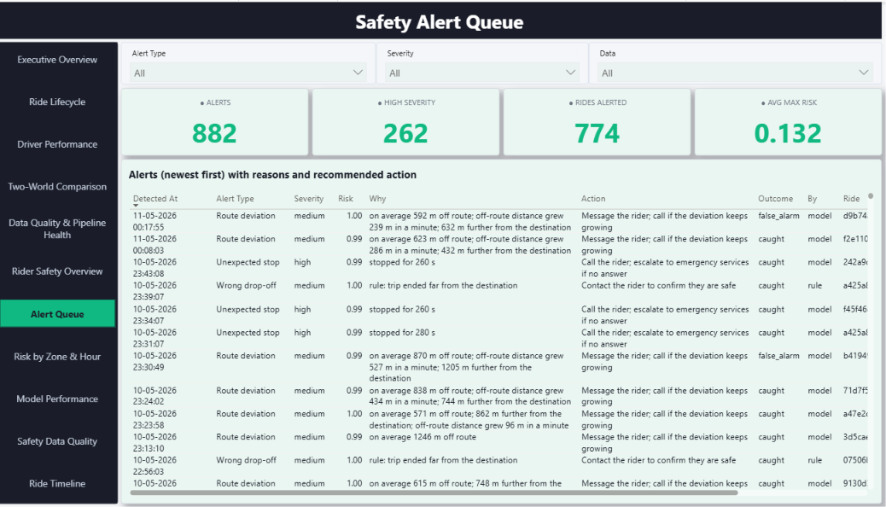
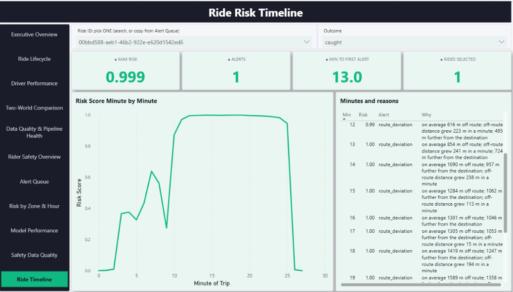
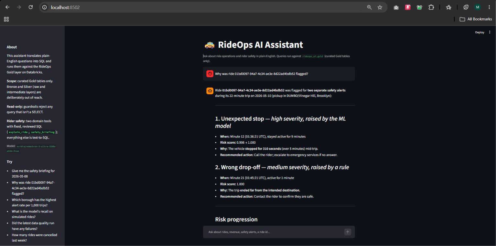
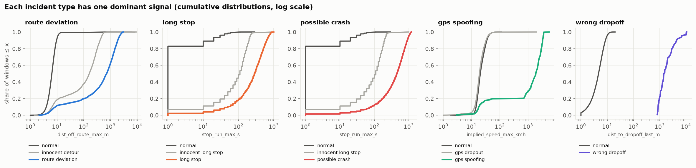
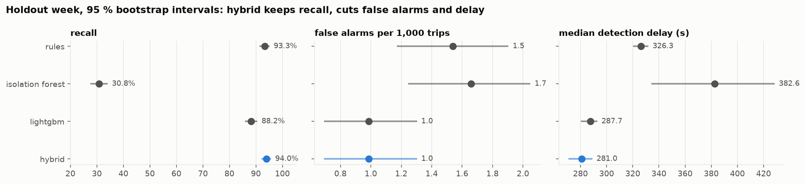

# RideOps AI: real-time rider safety on a Databricks lakehouse

A ride-hailing platform that watches every trip in progress and flags the ones where a rider may need help:
a car stopped mid-trip for minutes, a driver far off the planned route, a faked GPS position, a trip that ended
far from the destination. GPS pings stream through Azure into a medallion lakehouse; a hybrid of rules and a
LightGBM model scores every ride every 60 seconds; alerts land in Gold with plain-English reasons, and are served
to a Power BI dashboard and a natural-language assistant.


> All GPS and incidents are **simulated** (there is no public rider-safety dataset), but the simulator is
> calibrated on **15.35 M real NYC trips**: real roads, demand, traffic speeds and fares.

## Results (holdout week, never used in development)

| Detector | Incidents caught | False alarms / 1,000 trips | Median time to alert |
|---|---|---|---|
| Rules (baseline) | 93.3 % | 1.54 | 326 s |
| Isolation Forest (unsupervised) | 30.8 % | 1.66 | 383 s |
| **Hybrid: rules + LightGBM** | **94.0 %** | **0.99 (−36 %)** | **281 s (−45 s)** |

Paired bootstrap (both detectors on the same resampled trips): recall equal; false alarms and delay both
**significantly** lower. 41,578 trips, 845 incidents. Details: [model card](docs/MODEL_CARD.md).

## Architecture



One Databricks Job runs **pipeline → scoring → safety Gold → data quality** (defined as code, retries, e-mail on
failure). Training happens offline on a laptop with the **same feature code** the pipeline runs.

## How it works

1. **Data.** Simulator v2 drives rides along the real NYC road network (OSMnx, 55 k nodes), calibrated on
   15.35 M FHVHV trips (origin-destination matrix, hourly traffic, fare model R² 0.77). It injects 5 incident
   types (~2 % of trips) **and harmless look-alikes** (innocent long stops, detours) so false alarms are real.
   Live mode streams to Event Hubs; backfill mode writes Parquet that ADF lands in ADLS.
2. **Lakehouse.** Lakeflow Declarative Pipelines: Bronze validates the message contract and quarantines; Silver
   deduplicates, orders by event time, computes per-ping and per-minute features in one shared module
   ([`safety_features.py`](databricks/utilities/safety_features.py)), the same file used for training, so
   there is no training-serving skew. Warn-level expectations count GPS anomalies without dropping them (a
   GPS jump is a safety signal, not garbage).
3. **EDA.** Data audit, imbalance (1.9 % of trips, 0.7 % of minutes), effect sizes, hard negatives, PSI
   stability, feature engineering, rule baseline. [Findings](docs/EDA_FINDINGS.md).
4. **ML.** Rules vs Isolation Forest vs LightGBM vs hybrid, all tuned to the **same false-alarm budget**; a
   second simulated week as an untouched holdout; bootstrap confidence intervals; SHAP reason codes.
5. **Serving.** The detector is packaged as an MLflow model, registered in Unity Catalog as `@champion`, and
   scored with `spark_udf`; promoting or rolling back a model is an alias change, not a code change.
6. **Analytics.** Power BI on a composite model (Import for safety, DirectQuery for live operations, Dual for
   shared dimensions): overview, alert queue with reasons and actions, zone x hour risk, model performance,
   data quality, and a minute-by-minute ride timeline. [Dashboard](docs/DASHBOARD.md).
7. **AI assistant.** A LangGraph agent over 21 Gold tables with read-only guardrails, a semantic layer, two
   injection-proof domain tools (`explain_ride`, `safety_briefing`) and a 12-question evaluation graded
   against live data. [Assistant](docs/ASSISTANT.md).
8. **Operations.** Data quality checks with history (reconciliation, freshness, drift, alert-rate band);
   the whole chain as one Databricks Job, deployed from git. [Orchestration](docs/ORCHESTRATION.md).

## Screenshots

| Rider Safety Overview | Alert Queue |
|---|---|
|  |  |
| **Ride Timeline** (one caught incident) | **AI assistant** |
|  |  |

| Feature separation (EDA) | Holdout verdict (M11) |
|---|---|
|  |  |

## Engineering lessons (real bugs, found and fixed)

| Symptom | Root cause | Fix |
|---|---|---|
| 1 % of normal trips looked like GPS spoofing | Last ping arrived 0.05 s after the previous; 4 m of GPS noise read as 600 km/h | No speed from pings < 2 s apart: 10 false jumps per 1k trips → 0 |
| Model card and dashboard could disagree | Metrics computed twice (Python, Spark) | Spark Gold tested equal to `ml/metrics.py` on real data; the test caught a false-alarm definition mismatch |
| Model failed on Databricks | Wrapper class pickled from `__main__` (Python 3.11 bytecode) on a 3.12 cluster; "models from code" stored a Windows path | Wrapper in its own module (pickled by reference); test that the package is portable |
| New model version ignored | Spark cached the package by URI `@champion` | Resolve the alias to a version before scoring |
| Job failed only on Databricks | ANSI mode: division by zero for live rides (no incidents) | `try_divide`; local tests now run in ANSI mode |
| Power BI cards failed at random | 10+ concurrent DirectQuery queries per page on a small warehouse | Composite model: Import + DirectQuery + Dual |
| An LLM answer was wrong but sounded right | It quoted a number from its instructions instead of the data | Caught by the eval; prompt rule "compute from tables first" |

## Repository

```
simulation/, geodata/   simulator v2 (road network, calibration, incidents, live + backfill)
database/, adf/         PostgreSQL master data, Azure Data Factory pipelines (ARM export)
databricks/
  pipelines/            Lakeflow: bronze/, silver/, gold/ (incl. build_gps_silver.py)
  utilities/            safety_features.py, shared by pipeline and training
  jobs/                 score_safety, build_safety_gold, run_dq_checks + job definition
  deploy_job.py         deploys the job from git
ml/                     labels, metrics, rules, training, detector, MLflow packaging
notebooks/              10_safety_eda.ipynb, 11_safety_models.ipynb
RideOps Dashboard/      Power BI project (PBIP: TMDL model + PBIR report, plain text)
assistant/              LangGraph assistant, domain tools, evaluation, demo questions
tests/                  286 tests (pytest, local Spark in ANSI mode)
docs/                   design, findings, model card, dashboard, assistant, orchestration
```

## Running it

```bash
uv sync                                                   # Python 3.11 environment
python -m geodata.build_road_network                      # NYC road graph (once)
python -m simulation.run backfill --rides 50000 --start 2026-05-04 --days 7   # training data
python -m ml.build_features && python -m ml.train         # features, models, MLflow
python -m ml.serving --target databricks                  # register @champion (needs .env)
python databricks/deploy_job.py --run                     # deploy + run the Databricks job
python -m simulation.run live --rate 1 --duration 1800    # live GPS to Event Hubs
pytest                                                    # 286 tests
```

Secrets live in `.env` (see `.env.example`); nothing secret is committed.

## Documentation

| Doc | What it covers |
|---|---|
| [PROJECT_BRIEF](docs/PROJECT_BRIEF.md) | Problem, users, scope, success metrics |
| [DATA_DESIGN](docs/DATA_DESIGN.md) | Sources, contracts, layers, tables, quality rules, decisions (ADRs) |
| [EDA_FINDINGS](docs/EDA_FINDINGS.md) | What the data showed and the decisions it drove |
| [MODEL_CARD](docs/MODEL_CARD.md) | Model, data, results, limits, fairness, monitoring |
| [DASHBOARD](docs/DASHBOARD.md) | Pages and model design |
| [ASSISTANT](docs/ASSISTANT.md) | Agent, tools, guardrails, evaluation |
| [ORCHESTRATION](docs/ORCHESTRATION.md) | The Databricks Job and what is still manual |
| [V1_PLATFORM](docs/V1_PLATFORM.md) | The original operations platform: 8 injected defects, reconciliation, star schema |

## Limits

Simulated GPS and incidents: real-world precision would be lower, and the threshold must be re-tuned on real
outcomes (agent feedback as labels). The model sees trip geometry and timing only, no rider or driver identity.
About 6 % of incidents look exactly like harmless behaviour in GPS alone; closing that gap needs another signal
(in-app SOS, rider check-in).
