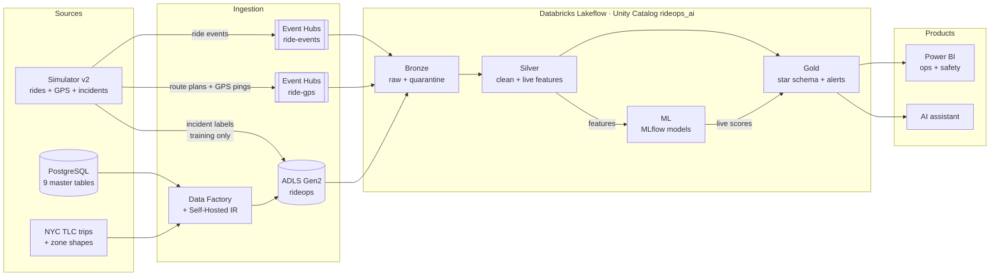
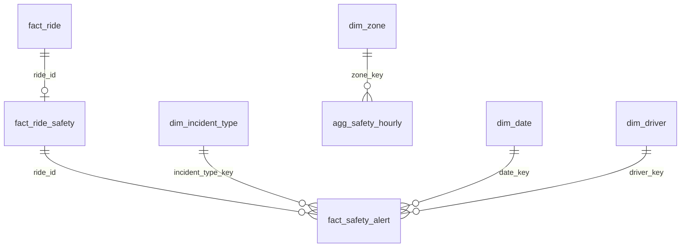

# RideOps AI: Data Design (v2, Rider Safety)

This document defines the data contracts, tables and design decisions for the v2 safety layer.
Everything from v1 (ride events, master data, NYC trips) stays as it is unless stated.
See [PROJECT_BRIEF.md](PROJECT_BRIEF.md) for the problem and success metrics.

---

## 1. Architecture

**New in v2:** the `ride-gps` hub, route plans, GPS pings, incident labels, live features, the ML layer, and safety tables in Gold.

---

## 2. Event Contracts

### 2.1 Ride event (v1, unchanged)
Lifecycle events `requested → assigned → accepted → arrived → started → completed | cancelled`, sent to hub `ride-events`.
Contract and required-by-stage rules are enforced in `databricks/pipelines/bronze/read_eventhub.py`.

### 2.2 Route plan (new, hub `ride-gps`)
Sent **once, when a trip starts**. It represents what a routing service gives the driver's app: the expected path.

| Field | Type | Rule |
|---|---|---|
| `message_type` | string | Always `route_plan` |
| `schema_version` | int | `1` |
| `message_id` | string (UUID) | Required, unique |
| `ride_id` | string (UUID) | Required; matches the ride event stream |
| `driver_id` | long | Required |
| `planned_at` | timestamp (UTC, ISO-8601 `Z`) | Required |
| `pickup_lat`, `pickup_lon` | double | Required, WGS84 |
| `dropoff_lat`, `dropoff_lon` | double | Required, WGS84 |
| `route_polyline` | string | Required; encoded polyline of the planned path |
| `planned_distance_m` | double | Required, > 0 |
| `planned_duration_s` | int | Required, > 0 |

### 2.3 GPS ping (new, hub `ride-gps`)
Sent **every 10 seconds** while the trip is in progress (`started` → `completed`).

| Field | Type | Rule |
|---|---|---|
| `message_type` | string | Always `gps_ping` |
| `schema_version` | int | `1` |
| `message_id` | string (UUID) | Required, unique (dedup key) |
| `ride_id` | string (UUID) | Required |
| `driver_id` | long | Required |
| `seq_no` | int | Required; 1, 2, 3… per ride (detects gaps and reordering) |
| `ping_ts` | timestamp (UTC, ISO-8601 `Z`) | Required; event time |
| `lat` | double | Required, −90 to 90 |
| `lon` | double | Required, −180 to 180 |
| `speed_kmh` | double | Required, ≥ 0 |
| `heading_deg` | double | 0 to 360, nullable |
| `accuracy_m` | double | GPS accuracy radius, ≥ 0 |

**Partition key:** `ride_id` on both hubs, so every message of a ride lands in one partition, in order.

### 2.4 Incident label (new, training data only)
Ground truth written by the simulator. **It never travels on the stream** (see ADR-010).

| Field | Type | Rule |
|---|---|---|
| `incident_id` | string (UUID) | Unique |
| `ride_id` | string (UUID) | Required |
| `incident_type` | string | One of the 5 types below |
| `start_ts` | timestamp (UTC) | When the incident starts in the GPS trace |
| `end_ts` | timestamp (UTC) | Nullable (e.g. trip ended early) |
| `severity` | string | `low` · `medium` · `high` |
| `params` | JSON string | Injected values, e.g. `{"stop_s": 540}` |

**Incident types**

| Code | Incident | How it shows in GPS |
|---|---|---|
| `route_deviation` | Driver leaves the planned route | Distance from route grows beyond a corridor |
| `long_stop` | Unexpected stop mid-trip | Speed ≈ 0 for minutes, away from pickup/dropoff |
| `wrong_dropoff` | Trip ends early or elsewhere | Last ping far from the planned dropoff |
| `possible_crash` | Sudden stop, then no movement | Large deceleration, then stationary |
| `gps_spoofing` | Fake location | Jump implying impossible speed (> 250 km/h) |

---

## 3. Reference Data

| Data | Source | Use |
|---|---|---|
| NYC taxi zone shapes | NYC TLC taxi zone shapefile | Pick realistic pickup/dropoff points inside zones |
| Zone centroids | Derived from shapes | Fallback points, map visuals |
| NYC road network | OpenStreetMap via OSMnx (cached locally) | Real routes for the simulator |

OpenStreetMap data is © OpenStreetMap contributors (ODbL); attribution goes in the README.

---

## 4. Tables by Layer

Catalog `rideops_ai`. Existing v1 tables are unchanged.

### Bronze (schema `bronze`)
| Table | Type | Content |
|---|---|---|
| `gps_messages_raw` | Streaming | Every contract-valid message from `ride-gps` (plans + pings), with Kafka lineage |
| `gps_messages_quarantine` | Streaming | Contract violations with the raw text and a reason: `malformed_json`, `unknown_message_type`, `null_required_field`, `invalid_timestamp`, `out_of_range_value` |
| `sim_gps_pings_raw` | Auto Loader | GPS pings of simulator backfill runs (training data), `_run_id` per row |
| `sim_route_plans_raw` | Auto Loader | Route plans of backfill runs |
| `safety_labels_raw` | Auto Loader | Incident ground truth from ADLS `labels/safety/` (ADR-010) |
| `safety_behaviors_raw` | Auto Loader | Every simulated behaviour (incidents and normal), for error analysis |
| `zone_geo_raw` | Batch | Zone centroids (lat/lon) |

Storage access: read-only expiring SAS token in secret scope `adls-creds` (Databricks Free Edition has no
Azure managed identity). The storage account name is pipeline configuration (`RideOps-Storage-Account`).

### Silver (schema `silver`)
Materialized views in `databricks/pipelines/silver/build_gps_silver.py`; `source` = `live` or the backfill run id.

| Table | Grain | Content |
|---|---|---|
| `sv_route_plans` | 1 row per ride | Planned route (encoded polyline), planned distance and duration |
| `sv_gps_pings` | 1 row per ping | Deduplicated by `message_id`, event-time order, per-ping features and flags (`is_gap`, `is_jump`, `is_outside_nyc`) |
| `sv_ride_live_features` | 1 row per ride per 60 s window | Model input (section 5) |
| `sv_safety_labels` | 1 row per incident | Cleaned labels (training and evaluation only) |

### ML (schema `ml`)
| Table | Content |
|---|---|
| `ml.training_windows` | Features joined with labels (window overlaps an incident = positive) |
| MLflow registry | `rideops_safety_unsupervised`, `rideops_safety_supervised` |

### Gold (schema `gold`)
| Table | Grain | Content |
|---|---|---|
| `dim_incident_type` | 1 row per type | 5 types + `none`, description, severity |
| `fact_safety_alert` | 1 row per alert | ride, type, risk score, reason codes, detected_at, model version |
| `fact_ride_safety` | 1 row per ride | Max risk, alert count, first alert time, final status |
| `agg_safety_hourly` | zone × hour × type | Alert counts and rates for dashboards |
| `ml_model_performance` | model version × date | Recall, precision, false alarms / 1,000 trips, detection delay |

---

## 5. Live Features

All features come from one file, `databricks/utilities/safety_features.py`, used both for local training and
inside the Silver pipeline, so training and scoring can never compute a feature differently.

**Per ping** (`sv_gps_pings`): `dist_off_route_m` (distance to the planned route), `progress_pct` (share of the
route driven), `dist_to_dropoff_m`, `time_vs_plan` (elapsed / planned duration), `implied_speed_kmh` (from
consecutive positions), `decel_kmh_per_s`, `stop_run_s` (seconds standing still so far), `dt_prev_s`.

**Per 60 s window** (`sv_ride_live_features`):

| Feature | Meaning | Main signal for |
|---|---|---|
| `dist_off_route_max_m`, `dist_off_route_mean_m` | Distance from the planned route | Route deviation |
| `stop_run_max_s`, `stationary_share` | Length of the current stop, share of pings standing still | Long stop, crash |
| `speed_before_stop_kmh` | Speed just before the current stop began | Crash |
| `speed_mean_kmh`, `speed_max_kmh`, `decel_max_kmh_per_s` | Movement | Crash |
| `implied_speed_max_kmh`, `n_jumps` | Physically impossible movement | GPS spoofing |
| `dist_to_dropoff_last_m`, `progress_pct_last`, `is_final_window` | Where the trip ended | Wrong drop-off, crash |
| `time_vs_plan_last` | Elapsed time vs plan | Detours, long stops |
| `gap_max_s`, `outside_nyc_share` | Data quality context | Avoiding false alarms |
| `hour_of_day`, `is_night` | Context | |

A live ride counts as ended (`is_final_window`) when its last ping is more than 60 s older than the newest live ping.

## 6. Data Quality Rules (GPS)

| Layer | Rule | Action |
|---|---|---|
| Bronze | Missing required field, bad type, lat/lon outside world range, unknown `message_type` | Quarantine |
| Silver | Duplicate `message_id` | Drop (within watermark) |
| Silver | Out-of-order `seq_no` | Reorder by `ping_ts` |
| Silver | Gap > 30 s between pings | Flag `is_gap` |
| Silver | Implied speed > 250 km/h | Flag `is_jump` (**not dropped**: it is a safety signal) |
| Silver | Point outside the NYC bounding box | Flag `is_outside_nyc` |
| Reconciliation | Pings sent vs landed vs quarantined | Must add up to 100% |

---

## 7. Volume and Run Modes

- Median trip ≈ 5 miles ≈ 20 min → **~120 pings per ride**.
- Live load ≈ `rides per second × 120` pings/s. One Event Hubs throughput unit accepts ~1,000 events/s, so live runs use **≤ 5 rides/s**.

| Mode | Output | Speed | Used for |
|---|---|---|---|
| **Backfill** | Files (JSON lines / Parquet) | As fast as possible, time-compressed | Training data (~50,000 rides, ~6M pings) |
| **Live** | Event Hubs, real-time emission | Wall-clock time | Streaming demo and live scoring |

Incident rate: about **2% of rides** (realistic, keeps the problem hard). Evaluation is always reported at this base rate.

---

## 8. Design Decisions

| ID | Decision | Reason |
|---|---|---|
| ADR-009 | Separate hub `ride-gps` | ~20× the volume of ride events and a different schema; separate scaling and consumers |
| ADR-010 | Incident labels never go on the stream | Prevents label leakage: scoring sees only what production would see |
| ADR-011 | GPS jumps are flagged in Silver, not quarantined in Bronze | A jump is both a data issue and a safety signal (spoofing) |
| ADR-012 | Route plan sent at trip start | Mirrors a real routing service; the expected path is known before deviations happen |
| ADR-013 | All new timestamps in UTC with `Z` | One time standard; convert to NYC time only for reporting |
| ADR-014 | Pings only during the trip (`started` → `completed`) | Rider-safety risk is highest on the trip; pickup phase can be added later |
| ADR-015 | Trip distance and duration come from the routed path | Keeps ride events, fares and GPS consistent (v1 drew distance at random) |
| ADR-016 | Backfill mode for training, live mode for serving | Real-time generation is too slow for a training set |
