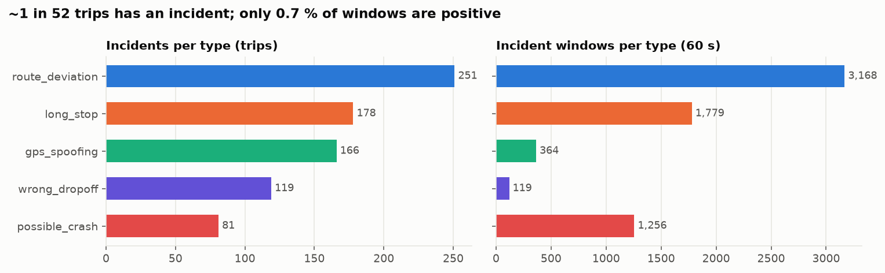
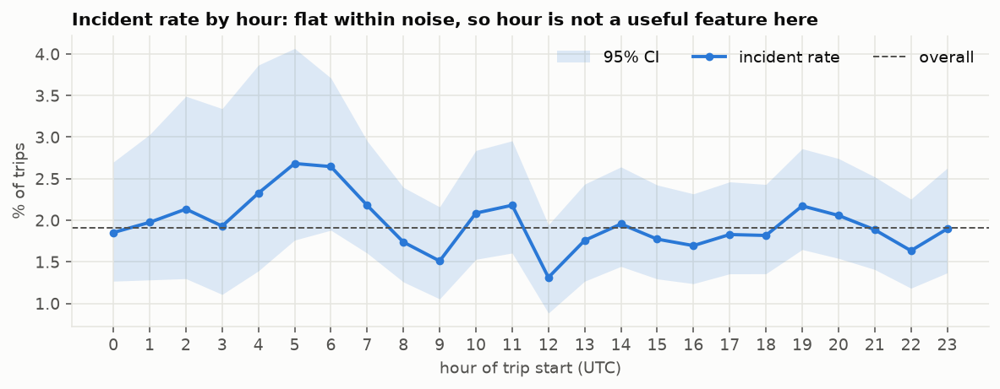
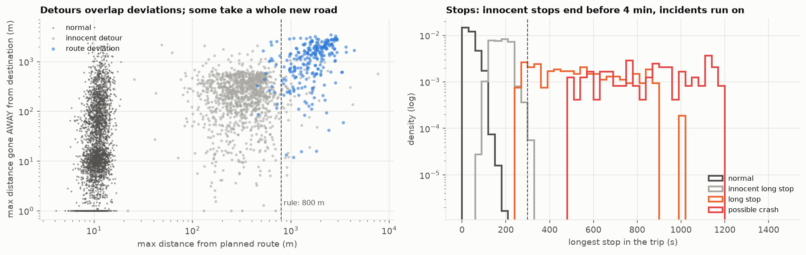
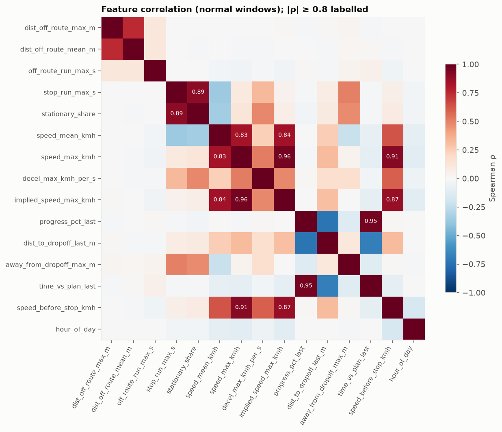
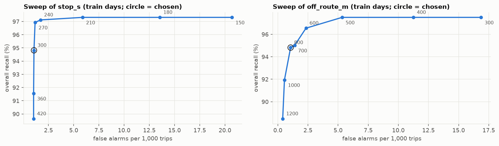

# Rider-Safety EDA: Findings (M10)

**Question:** can a GPS stream tell a safety incident from a normal trip, minute by minute, without drowning the
safety team in false alarms?

**Data:** simulator backfill `run_2026-05-04_7d_50000r_seed42`: 7 days, 41,726 completed trips, 5.48 M GPS
pings, 926 k one-minute windows, 795 incidents. Features come from `databricks/utilities/safety_features.py`, the
same file the Silver pipeline runs.

**Full analysis:** [`notebooks/10_safety_eda.ipynb`](../notebooks/10_safety_eda.ipynb) ·
**Reproduce:** `python -m ml.build_features`, then run the notebook.

---

## Summary

| # | Finding | Decision |
|---|---|---|
| 1 | Pings are clean: 99.2 % exactly 10 s apart, 0.1 % gaps, GPS accuracy p99 8 m; normal trips stay within 12 m of the route (p99) | Features can be trusted |
| 2 | **Bug found:** pings < 0.3 s apart made 10 false "GPS jumps" per 1,000 normal trips | Fixed in the shared feature module: now 0 |
| 3 | Extreme imbalance: 1.9 % of trips (95 % CI 1.8–2.0 %), 0.7 % of windows | Event-level metrics, never accuracy |
| 4 | Incident rate does not depend on the hour (χ² p = 0.75) | Hour left out of the model |
| 5 | Each incident type has one dominant signal (AUC 0.94–1.00) | A strong rule baseline is possible |
| 6 | False alarms come from hard negatives: innocent detours that become a new road, innocent stops up to 320 s | The real problem for ML |
| 7 | 7 feature pairs with \|ρ\| ≥ 0.8 | Drop one per pair for linear models and SHAP |
| 8 | All model features stable across days (PSI < 0.1) | Time-based split is safe |
| 9 | Two new features lift the hardest case from AUC 0.67 to 0.77 | Added to the shared module |
| 10 | **Rule baseline (test day):** recall 96.6 %, 1.7 false alarms / 1k trips, median delay 5 min | The bar for M11 |

---

## 1. Data quality

| Check | Result |
|---|---|
| Pings exactly 10 s apart | 99.2 % |
| Gaps > 30 s | 0.1 % of pings |
| GPS accuracy p50 / p99 | 5.6 m / 8.0 m |
| Normal trips: distance to route p50 / p99 | 2.7 m / 12.4 m |
| Pings without a route plan | 0 |

**Bug found by the audit.** About 1 % of normal trips showed an implied speed above 250 km/h, which a spoofing rule
would flag. The cause: a trip's last ping arrives 0.001–0.3 s after the one before it, and 4 m of GPS noise over
0.05 s reads as 600+ km/h. **Fix:** no speed is computed from pings closer than 2 s (`MIN_DT_S`).

| | Normal trips with a "jump" | Per 1,000 trips |
|---|---|---|
| Before the fix | 420 | 10.3 |
| After the fix | 0 | 0 |

## 2. Target

- 1.9 % of trips have an incident; only **0.7 % of one-minute windows** are positive.
- Accuracy is meaningless here (always saying "normal" scores 99.3 %). Metrics are event-level: recall per incident,
  false alarms per 1,000 trips, detection delay.

Day 1.9 % vs night 2.0 %: chi-square p = 0.75, so no time-of-day effect. Hour is not used as a feature.

## 3. Which signal detects which incident

| Incident | Best feature | AUC | Cliff's δ |
|---|---|---|---|
| Possible crash | share of time standing still | 0.99 | 0.98 |
| Long stop | length of the current stop | 0.98 | 0.96 |
| GPS spoofing | distance from route (the fake position) | 0.97 | 0.93 |
| Route deviation | max distance from route | 0.94 | 0.87 |
| Wrong drop-off | final distance to destination | 1.00 | 1.00 |

With 900 k windows every p-value is ~0, so decisions use the **effect size** (AUC, Cliff's δ), not p.

## 4. Hard negatives: where false alarms come from

- **Stops:** innocent stops last up to 320 s; long stops start at 280 s. A 40-second overlap band.
- **Detours:** 46 innocent detours (3.8 %) went beyond 800 m off route. Some turned into a **completely new road**
  to the destination: one ran 7.7 km off route for 80 minutes and was still a normal trip. In a real app that is
  everyday re-routing, so "far from the planned route" is not enough. The question is also *is the car still
  closing in on the destination?*

## 5. Redundancy and stability

- Strongest pairs: max speed vs implied speed (ρ 0.96), progress vs time-vs-plan (0.95), stop length vs share
  standing still (0.89). Harmless for tree models; drop one per pair for linear models and clean SHAP readings.
- Population Stability Index between the training days and the validation/test days: < 0.1 for every model
  feature. Only `hour_of_day` moves (0.12, weekday traffic mix). Training on days 1–5, validating on day 6 and
  testing on day 7 is safe.

## 6. Feature engineering

Added to the **shared** module, so the Silver pipeline computes them exactly as training does:

| Feature | Meaning |
|---|---|
| `off_route_run_max_s` | seconds the car has stayed more than 100 m off route without a break |
| `away_from_dropoff_max_m` | distance gone back from the closest point to the destination so far |

Both use only past pings, so they work live. Tested on the hardest windows (off-route windows of deviations vs
innocent-detour trips) with 5-fold cross-validation **grouped by ride**:

| Features | AUC |
|---|---|
| Distance from route | 0.673 |
| + time off route | 0.741 |
| + away from destination | 0.736 |
| **All three** | **0.765** |

Alone, neither new feature beats distance. Together they add 0.09 AUC, because they describe different things:
how far, how long, and in which direction. A threshold rule cannot combine them; a model can.

Tried and **rejected**: 60-second change in distance to drop-off (too noisy), hour/night flag (no effect),
deceleration before a stop (crashes brake no harder than long stops in this data).

## 7. Rule-based baseline

`ml/rules.py`: four readable rules, thresholds tuned on the training days only.

| Rule | Fires when |
|---|---|
| Unexpected stop (long stop or crash) | standing still > 300 s |
| GPS spoofing | implied speed > 250 km/h |
| Route deviation | > 800 m from the planned route |
| Wrong drop-off | trip ended > 500 m from the destination |

A crash looks exactly like a long stop while it is happening, so one stop rule covers both. Conditions that did not
change recall or false alarms on the training days were removed.

| | Train | Valid | **Test** |
|---|---|---|---|
| Recall | 94.8 % | 90.4 % | **96.6 %** |
| Precision (alerted trips) | 93.7 % | 92.8 % | **91.9 %** |
| False alarms / 1,000 trips | 1.06 | 1.15 | **1.69** |
| Median detection delay | 321 s | 322 s | **305 s** |

Test day by type:

| Incident | Recall | Median delay |
|---|---|---|
| GPS spoofing | 100 % | 34 s |
| Wrong drop-off | 100 % | 22 s |
| Possible crash | 100 % | 346 s |
| Long stop | 95 % | 339 s |
| Route deviation | 93 % | 322 s |

All 11 false alarms on the test day were innocent detours or re-routes.

## What M11 must beat

Spoofing and wrong drop-offs are already caught in under a minute. The room for ML is:

1. **Detection delay** for crashes, long stops and deviations: about 5–6 minutes with rules, because a threshold has
   to wait until the stop or the distance is unambiguous.
2. **Detour and re-route false alarms**, which only a combination of distance, duration and direction can separate.

The test day holds 118 incidents, so M11 reports confidence intervals and chooses thresholds on the validation day
only.
