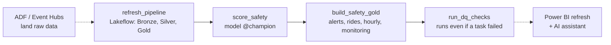

# Orchestration (M15)

One Databricks Job runs the whole rider-safety chain. It is **defined as code**
(`databricks/jobs/rideops_safety_job.json`) and deployed with `databricks/deploy_job.py`, so every change to the
schedule, retries or task order goes through git and review, never through ad-hoc clicks.

```
python databricks/deploy_job.py          create the job, or update it in place (looked up by name)
python databricks/deploy_job.py --run    ... and run it now, wait, print each task's result
```

## The chain



| Task | Type | Retries | Timeout | Why this way |
|---|---|---|---|---|
| `refresh_pipeline` | Pipeline task | 1 (5 min apart) | 60 min | Incremental update only, **never a full refresh**: Bronze streaming tables keep history whose source has expired |
| `score_safety` | Notebook | 2 (2 min) | 30 min | Scores only after Silver is current; loads the model by alias, so promoting a model needs no job change |
| `build_safety_gold` | Notebook | 2 (2 min) | 30 min | Reads the scores just written |
| `run_dq_checks` | Notebook, `run_if: ALL_DONE` | 1 | 30 min | Runs even when an earlier task failed, so the failure is recorded in `gold.dq_check_results` |

Job-level: one run at a time (`max_concurrent_runs: 1`, queued), 2-hour overall timeout, **e-mail on failure**,
tags `project=rideops-ai`. Schedule: daily 06:00 Asia/Kolkata, **paused** by default (Free Edition compute is
limited; switch it on in the job's Schedule panel).

## First run (2026-10-30)

| Task | Result | Duration |
|---|---|---|
| refresh_pipeline | SUCCESS | 645 s |
| score_safety | SUCCESS | 115 s |
| build_safety_gold | SUCCESS | 31 s |
| run_dq_checks | SUCCESS | 26 s |

About 14 minutes end to end; data quality: 11 pass, 0 fail (the warning is live GPS freshness while the live
simulator is off). Re-deploying updated the same job in place (tested), so the deploy is idempotent.

## What is still manual, and how it would be automated

| Step | Today | In production |
|---|---|---|
| Ingestion (ADF) | ADF triggers exist but are stopped (home upload bandwidth) | ADF pipeline ends with a Databricks Job activity that starts this job |
| Live GPS | `python -m simulation.run live` on demand | A streaming source; the pipeline in continuous mode |
| Power BI | Desktop: Home > Refresh | Publish to the Power BI service, scheduled refresh after the job |
| Model retraining | `python -m ml.train` + `python -m ml.serving --target databricks` | A training job triggered when the drift checks (PSI) warn |
